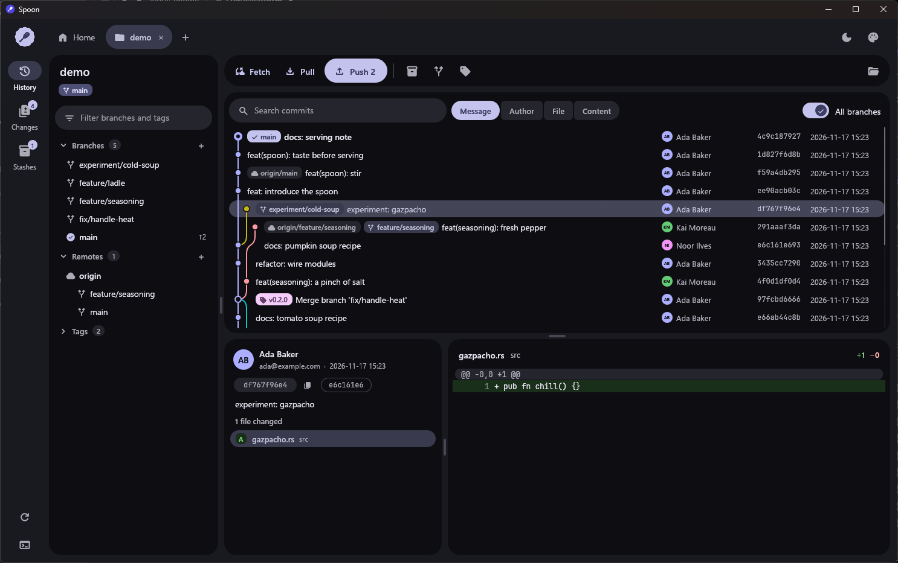

# Spoon


A Git GUI client written in Rust, with a Material 3 Expressive interface.
Spoon is a from-scratch rewrite of [SourceGit](https://github.com/sourcegit-scm/sourcegit) (C#/Avalonia).
It runs on Windows and Linux.



## What it does

- Commit graph with branches, tags and remote refs; search by message, author, file or content
- Local changes: stage, unstage, discard, commit, amend, sign off, commit and push
- Branches: create, check out, rename, delete, track remote branches
- Merge (default, no fast-forward, fast-forward only, squash), rebase, cherry-pick, revert, reset
- Conflicts: resolve with ours or theirs, then continue, skip or abort
- Remotes: fetch, pull (merge or rebase), push (with lease), add and remove remotes
- Tags and stashes, including pushing and deleting tags on a remote
- Unified diff viewer, file history, blame, command log
- Clone, init, tabs for several repositories, submodule and worktree lists

Not ported from SourceGit yet: interactive rebase, hunk and line staging, a merge
conflict editor, git-flow, LFS, bisect, image diff, statistics, custom actions,
workspaces, issue links, AI commit messages, translations, per-remote SSH keys.

## Requirements

- Git 2.25 or newer on `PATH`
- Rust 1.97 or newer to build
- Linux: a desktop with X11 or Wayland, `fontconfig` (for the system UI font), and
  `xdg-desktop-portal` (for the folder picker)

Network operations use your git credential helper or SSH agent. Spoon does not ask
for passwords itself.

## Build and run

```sh
cargo run --release
cargo run --release -- /path/to/repository
```

On Linux, install the launcher entry with `assets/spoon.desktop` and `assets/spoon.svg`.

## Windows installer

Needs [Inno Setup 6](https://jrsoftware.org/isinfo.php) (`winget install JRSoftware.InnoSetup`).

```sh
cargo build --release
iscc installer\spoon.iss
```

This writes `target\installer\Spoon-<version>-x64-setup.exe`. The installer takes its
version from `Cargo.toml`, installs per user without an admin prompt (or for all users
on request), adds a Start menu entry and an uninstaller, and warns when Git is missing.
The exe links the C runtime statically (`.cargo/config.toml`), so no VC++ redistributable
is needed. The installer is not code signed, so Windows SmartScreen will warn on download.

## Tests

```sh
cargo test
```

The suite in `src/tests.rs` runs real git in throwaway repositories, with bare
repositories as remotes. It goes through the same `Op` and query API as the UI:
staging, commits, branches, merges, rebases, cherry-picks, reverts, resets, tags,
stashes, push, pull, fetch, conflicts with abort and continue, and rejection of
option-like names. The tests ignore your global git config.

## Appearance

The palette icon in the top bar opens the appearance settings. As with Material You
on Android, every color comes from one source color:

- theme: system, light or dark
- source color: presets or any custom color
- palette style: tonal spot, vibrant, expressive, neutral, rainbow, fruit salad, monochrome
- contrast: standard, medium or high

Preferences are stored in `%APPDATA%\Spoon\preference.json` on Windows and in
`$XDG_CONFIG_HOME/spoon/preference.json` (or `~/.config/spoon`) on Linux.

## Layout of the code

| File | Purpose |
|------|---------|
| `src/git.rs` | Every git invocation, parsers, and the `Op` type for all mutations |
| `src/graph.rs` | Commit graph lane layout |
| `src/diff.rs` | Unified diff parser |
| `src/theme.rs` | Material 3 color roles from a seed, type, shape, egui style |
| `src/widgets.rs` | Material 3 Expressive components |
| `src/repo.rs` | Repository view: history, changes, stashes |
| `src/dialogs.rs` | Operation dialogs |
| `src/app.rs` | Tabs, welcome page, clone, appearance settings |
| `src/icon.rs` | The logo, generated in code (`spoon --export-logo assets`) |
| `src/tests.rs` | Git workflow tests |

## License

MIT, see `LICENSE` and `THIRD-PARTY-LICENSES.md`.
